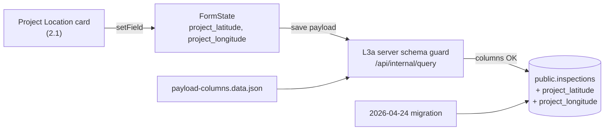

# Inspection Form Comments — Design

**Date:** 2026-04-24
**Owner:** Engineering
**Source:** `comments on inspection.docx` (RWB inspector feedback)
**Scope:** Cosmetic + structural cleanup of the inspection editor used by
assessor / reviewer / verifier / approver pages. Two new database columns,
one new tiny API, one tiny new component. No workflow / RLS / role changes.

---

## 1. Why

RWB inspectors flagged ten distinct issues with the on-screen inspection form
during the April field trial. The form was conflating three different concepts
("residence", "permit location", "water source location") and renumbering
exposed several duplicated/dead sections after earlier merges. This spec
collects every fix in one pass so we can stop iterating section-by-section.

---

## 2. Issue → fix mapping

| # | Comment from `comments on inspection.docx` | Fix |
|---|---|---|
| 1 | `Residence` (Section 1) auto-fills the water source location | Stop using `locationChain` / water-source `location` as the fallback. Use only `applicant.address` / `applicant.company_address`. Registry-only path leaves it blank (`'N/A'`). Field is already wrapped in `EditableLockedField`, so it becomes a yellow editable input the assessor must fill in. Added `description: "Permit holder's head office address"` so the intent is unambiguous. |
| 2 | `Name of facility/project` is not required | Field removed from `inspection-form-layout.tsx`, prop removed from `InspectionLockedData`, derivation removed from `lib/inspection-utils.ts`, prop removed from all four editor pages. Permit-transfer feature has its own unrelated `facilityProjectName` and is untouched. |
| 3 | `Permit Location` (Section 2.1) → `Project Location` + needs coordinates because the activity site can sit far from the water source | Title renamed; description added explaining the distinction. Two new optional `numeric` columns `project_latitude` / `project_longitude` on `public.inspections`. New `NumberField` controls bound to them. |
| 4 | Water Source Type should be derivable from the source name | Added `deriveWaterSourceTypeFromName()` in `lib/inspection-utils.ts` with a keyword catalogue (Spring, Lake, River, Stream, Borehole, Well, Dam, Reservoir, Pond, Marsh, Wetland, Swamp). Used as a final fallback in both the application-backed and registry-backed derivation paths. The field stays editable via `EditableLockedField`. |
| 5 | Catchment Level I / II should be picklists (free-text + autocomplete from prior values) | New `GET /api/inspections/catchment-suggestions` endpoint returning distinct catchment values from `public.inspections`. New `<CatchmentAutocomplete>` component (cmdk-based dropdown next to a free-text input). Wired into Section 2.2 in place of the two `EditableLockedField` calls — only when the locked value is empty (so assessor can override). |
| 6 | Section `2.3 Abstraction & Volume` is duplicated by Section 5–6 | Removed from the authorization template branch. Concession `2.3 Concession Area` block kept as-is. |
| 7 | Section `2.4 Water Source Coordinates` should be merged into `2.2` | `2.4` SectionShell deleted. Latitude/Longitude moved to a two-column row at the bottom of the `2.2 Water Source & Purpose` card. |
| 8 | Section 7 (`Activity in which water is used`) should be removed | SectionShell deleted. `activity_type` and `activity_starting_date` columns kept in DB and still backfilled from the locked-data forwarding so historical reporting/PDFs don't break. The columns are flagged `deprecated` in `payload-columns.data.json`. |
| 9 | Inline "(Add pictures)" hints in Sections 5–6 and 8 | Removed from `Type of water measurement device in place`, `Effectiveness of the system`, and `Description of any initiative by the water user to protect the catchment`. Documents tab already carries the global "upload all photos here" tip. |
| 10 | `Total Workers` row in Section 5.1 should be auto-calculated vertically | The Totals row is fully derived. Both inputs are disabled (greyed). On every other row's change we recompute `male = sum(skilledPermanent.male, unskilledPermanent.male, skilledTemporary.male, unskilledTemporary.male)` and similarly for `female`, then call `computeEmploymentTotal` for the `total` cell. The recomputed totals row is persisted into `employment_gender_breakdown` JSONB so PDFs/exports stay correct. |

### Renumbering scheme (consecutive)

| Before | After |
|---|---|
| 1. Permit Holder Identification | 1. Permit Holder Identification |
| 2. Permit Particulars | 2. Permit Particulars |
| 2.1 Permit Location | 2.1 Project Location |
| 2.2 Water Source & Purpose | 2.2 Water Source & Purpose (now also contains Lat/Lng) |
| 2.3 Abstraction & Volume (auth) | _removed_ |
| 2.3 Concession Area (concession) | 2.3 Concession Area (unchanged) |
| 2.4 Water Source Coordinates | _merged into 2.2_ |
| 5–6. Water abstraction (Authorization) | 3. Water Abstraction (Authorization) |
| 5–6. Concession (Surface area & boundaries) | 3. Concession (Surface area & boundaries) |
| 7. Activity in which water is used | _removed_ |
| 8. Wastewater management system | 4. Wastewater Management System |
| 9. Social and Gender-Disaggregated Information | 5. Social and Gender-Disaggregated Information |
| 9.1 Employment Related to Water Use Activity | 5.1 Employment Related to Water Use Activity |
| 9.2 Occupational Health and Safety | 5.2 Occupational Health and Safety |
| 10. Pending fees | 6. Pending Fees |
| 11. Water User Annual Report | 7. Water User Annual Report |
| 12. Water use conflicts | 8. Water use conflicts |
| 13. Catchment protection initiatives | 9. Catchment protection initiatives |
| 14. Conclusion and recommendations | 10. Conclusion and recommendations |

---

## 3. Files touched

**Modified**
- `components/inspection/inspection-form-layout.tsx` — labels, removals, totals row, autocomplete wiring, project coordinate fields, optional `description` prop on `EditableLockedField`/`ReadonlyField`.
- `lib/inspection-utils.ts` — fixed Residence derivation (both paths), added `deriveWaterSourceTypeFromName()` and used it as the final fallback for `waterSourceType` (both paths), removed `facilityProjectName` from `InspectionLockedData` and from both derivation paths.
- `lib/inspections/payload-columns.data.json` — registered `project_latitude` / `project_longitude`; added deprecation comments for `activity_type` / `activity_starting_date`.
- `app/{assessment,review,verification,approver}/inspection/permit/[id]/page.tsx` — removed `facilityProjectName` forwarding; added `project_latitude` / `project_longitude` to the local `FormState` and to the save payload.

**New**
- `database/migrations/2026-04-24-inspection-project-coordinates.sql` — `ADD COLUMN IF NOT EXISTS project_latitude numeric, project_longitude numeric;` + `pg_notify('pgrst', 'reload schema')`.
- `app/api/inspections/catchment-suggestions/route.ts` — distinct values endpoint, 60s in-memory cache, soft-fails to empty arrays so the field still works as plain input if the API errors.
- `components/inspection/catchment-autocomplete.tsx` — `cmdk` + popover wrapped around a free-text `Input`; module-level cache so multiple instances on the page only fetch once.

---

## 4. Data flow for the new project coordinates



The schema-drift defense built on 2026-04-22 (server-side `getTableColumns`
guard + client-side `assertInspectionPayloadKeys`) automatically picks up
the two new columns from the registry. No code changes to the guard.

---

## 5. What the user has to do

Run this single SQL on **prod** and **staging** Supabase:

```sql
ALTER TABLE public.inspections
  ADD COLUMN IF NOT EXISTS project_latitude  numeric,
  ADD COLUMN IF NOT EXISTS project_longitude numeric;
SELECT pg_notify('pgrst', 'reload schema');
```

Until the migration runs, saving an inspection with non-null project
coordinates will hard-fail with a clear "missing column" error from the
schema guard (this is the intended safety-net behaviour).

---

## 6. Out of scope

- Concession-template specific layouts (only touched where the 2.4 merge and
  the renumbering pass require)
- PDF/export templates beyond removing the deleted `facilityProjectName`
- Workflow / status / RLS changes
- Backfilling existing rows (deprecated `activity_*` data is left as-is)

---

## 7. Validation

- `npx tsc --noEmit` — no new errors introduced (verified via stash before/after diff)
- Lint clean for all touched files
- Manual smoke for `assessment/inspection/permit/<id>` on both an authorization-template and a registry-only permit:
  - Residence is empty (registry-only) and editable, with the "head office address" hint
  - Project coordinates persist on save & survive refresh (after migration)
  - Catchment autocomplete shows past values, accepts new free-text values
  - Water source type pre-fills `Spring` for `Kabonobono Spring`-style names
  - Section 7 absent; sections renumbered as above
  - Total Workers row reflects column sums and is read-only; persisted in JSONB
- `npm run audit:inspections-schema` — clean once migration applied
